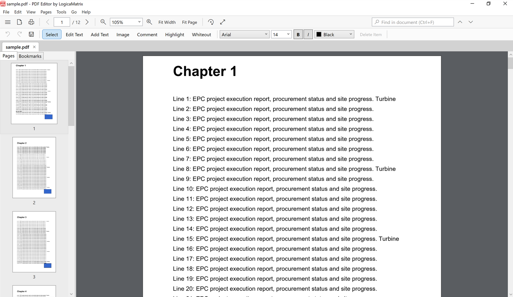

# PDF Editor by LogicaMatrix

**A free PDF viewer and editor for Windows.** View, edit, merge, split, compress and convert PDF files, with every document in its own tab.



## Download

### [Download PDF Editor for Windows](https://github.com/murarikiran/pdfeditor/releases/latest)

On the page that opens, find **Assets** and click **`PDFEditor-Setup-…exe`** to download it, then run it. You do not need the other two files (`latest.json`, `latest.json.sig`); the app uses those to check for updates.

**Requirements:** Windows 10 or 11 (64-bit). The download is about 8 MB.

## How to install

1. **Download** `PDFEditor-Setup-…exe` from the [latest release](https://github.com/murarikiran/pdfeditor/releases/latest).
2. **Run it.** If Windows shows a blue *"Windows protected your PC"* window, click **More info**, then **Run anyway** (see [Why does Windows show a warning?](#why-does-windows-show-a-warning)).
3. **Follow the wizard.** By default it installs for your own account and does not need administrator rights.
4. **If the Microsoft .NET 8 Desktop Runtime is missing,** setup downloads it from Microsoft and installs it for you. Windows asks for permission once, and an internet connection is needed for that step.
5. *(Optional)* Keep **"Open PDF files with PDF Editor"** ticked. To make it your default PDF app, choose it in **Settings > Apps > Default apps** (Windows asks you to confirm this yourself).

## What it can do

**View**
- Open many PDFs at once, each in its own tab (drag and drop works too)
- Thumbnails, bookmarks, zoom, fit width / fit page, rotate, search, full screen
- Password-protected PDFs and printing

**Edit**
- Change existing text, add new text (font, size, bold, italic, colour)
- Insert images, add comment notes, highlight, and cover areas with a solid colour
- Move and resize anything you add, with undo and redo

**Manage pages**
- Delete, rotate and reorder pages
- Insert blank pages or pages from another PDF, append a PDF, extract pages to a new file

**Tools menu**
- Merge PDFs, split a PDF, compress a PDF
- Export pages as PNG or JPEG images, create a PDF from images
- Word to PDF and PDF to Word
- Add a text or image watermark, and remove watermarks that are stored as separate objects in the file

Notes: *Word to PDF* needs Microsoft Word or LibreOffice on your PC, and *PDF to Word* gives the best layout when Microsoft Word is installed. *Compress* mainly shrinks PDFs made of photos or scans, and a PDF that is already small may not shrink. *Change existing text* covers the old text with the new text rather than deleting it from the file, so do not use it to redact sensitive information.

## Free software

PDF Editor by LogicaMatrix is **free software**, free to use.

## Updates

The app checks for a new version shortly after it starts (about once a day). If one is available it shows a banner, and **nothing is installed unless you click "Update now"**. You can turn the check off, or check by hand, under **Help**. Update information is digitally signed, so the app ignores anything that was not published by LogicaMatrix.

## Your documents and privacy

Your PDFs stay on your computer; the app never uploads them. The only network use is the update check (a plain download from GitHub, with no personal information) and, during setup, the Microsoft .NET runtime download if it is needed.

## Why does Windows show a warning?

Windows SmartScreen warns about installers from publishers it does not recognise yet, and this installer is not signed with a paid publisher certificate. The warning does not mean the file is harmful. To confirm your download is genuine, compare its checksum with the one on the release page. In PowerShell:

```powershell
Get-FileHash .\PDFEditor-Setup-1.0.0.exe -Algorithm SHA256
```

(Use the file name you downloaded.) The result must match the **SHA-256** shown in the release notes.

## Uninstall

**Settings > Apps > Installed apps**, find *PDF Editor by LogicaMatrix*, and choose **Uninstall**.

## Help and feedback

- Found a problem or have an idea? [Open an issue](https://github.com/murarikiran/pdfeditor/issues).
- Website: [www.logicamatrix.in](https://www.logicamatrix.in)

## About

**PDF Editor by LogicaMatrix** is developed by **LogicaMatrix Technologies Private Limited**.
This repository hosts the downloadable releases. The app includes open-source components (PDFsharp, PdfPig and the Microsoft .NET runtime); their licenses are listed in the app under **Help > Third-Party Licenses**.

&copy; 2026 LogicaMatrix Technologies Private Limited. All rights reserved.
